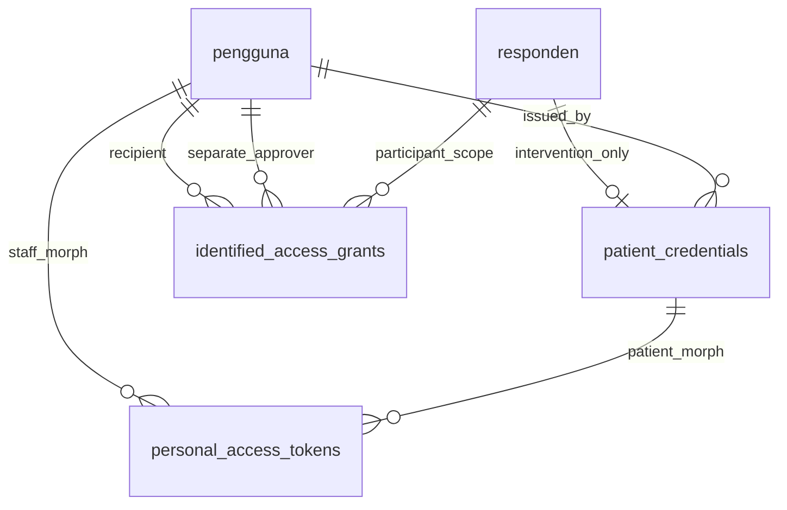

# Authentication schema extension v1.1 (PR-03)

Additive migration `2026_11_03_000003_create_authentication_foundation.php` builds
on PR-02 without altering its tables, constraints or immutable audit triggers.
The [v1.0 dictionary](data-dictionary-v1.0.md) remains the research-schema reference;
this extension covers authentication storage only.

| Table | Fields and types | Integrity / purpose |
| --- | --- | --- |
| patient_credentials | responden_id CHAR(36) PK; kelompok VARCHAR(16); pin_hash VARCHAR(255); issued_by BIGINT UNSIGNED; issued_at DATETIME(6); revoked_at DATETIME(6) NULL; timestamps(6) | 1:1 participant; composite participant/group FK and INTERVENSI CHECK; staff issuer FK; hash-prefix/length CHECK rejects plaintext-looking PINs. No PIN column. |
| personal_access_tokens | id BIGINT UNSIGNED PK; tokenable_type VARCHAR(16); tokenable_id VARCHAR(36); name VARCHAR(255); token CHAR-compatible VARCHAR(64) UNIQUE; abilities TEXT NULL; last_used_at TIMESTAMP NULL; expires_at TIMESTAMP NOT NULL; timestamps | Sanctum token hashes only; stable staff/patient morph types, composite principal index and expiry index. String key handles separate BIGINT staff and UUID patient identities. |
| identified_access_grants | id BIGINT UNSIGNED PK; pengguna_id/approved_by BIGINT UNSIGNED FKs; responden_id CHAR(36) FK; purpose_code VARCHAR(80); starts_at/expires_at DATETIME(6); revoked_at DATETIME(6) NULL; timestamps(6) | Different approver required; positive time window; ASCII uppercase purpose code; participant/user/expiry index. Policies additionally enforce active researcher approval, ADMIN_IT recipient, expiry maximum and blinding. |
| auth_rate_limits | key VARCHAR(255) PK; value MEDIUMTEXT; expiration INT indexed | Laravel shared database-cache counters/timers. Keys contain HMACs, not respondent codes, emails or IPs. |
| auth_rate_limit_locks | key VARCHAR(255) PK; owner VARCHAR(255); expiration INT | Database cache lock support; no credentials or clinical data. |

All concrete FKs RESTRICT updates/deletes. Sanctum's token principal is a
polymorphic reference with a fixed `staff`/`patient` morph map and CHECK; there is
no cross-table polymorphic FK. A missing principal cannot authenticate; Eloquent
credential/status changes and explicit revocation delete applicable tokens.
Expiration denies tokens without needing a cleanup job. Token names/abilities
are server-selected, not client role claims. `expires_at` cannot be NULL.
Application queries check active principal/group on every protected request.

PINs/passwords use Laravel hashing; hash-format CHECKs are structural defense,
not a substitute for model/service hashing. No credentials or account rows are
seeded by migrations. Identity/contact separation in PR-02 is preserved.
Audit events append to the existing `audit_log`; no new mutable audit store is
introduced. Grants are authorization records and do not embed clinical content.

The final two ERD links are logical Sanctum morph relationships rather than
SQL FKs. The cache tables are intentionally unrelated to research data.

Validate only in disposable MySQL. The ordinary suite uses transactions. The
opt-in `AuthenticationMigrationTest` requires its own initially empty schema
ending `_auth_migration_test`: it applies the PR-02 migrations, creates explicitly
synthetic records, applies PR-03, rolls back only PR-03, and verifies preserved
participant data and audit immutability before reapplying. It must never run on
an existing research or development database. CI runs this separately from the
empty-schema full lifecycle test. No startup migration or destructive data reset
is introduced.
