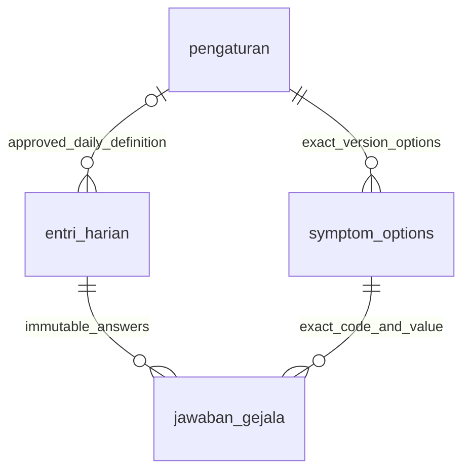

# Daily assessment provenance — PR-11 additive amendment

Migration: `2026_11_07_000006_add_daily_assessment_provenance.php`.
No historical migration, PIN semantics, patient identity column, record or trigger
is changed. Apply through the normal reviewed migration process; this PR performs
no deployed migration, reset or seed.

| New entri_harian column | Definition | Meaning |
| --- | --- | --- |
| assessment_setting_id | nullable unsigned BIGINT, indexed restrictive FK to pengaturan.id | Immutable daily instrument provenance. Application enforces daily_assessment namespace and approval. NULL on historical/factory records. |
| submission_fingerprint | nullable CHAR(64), hidden in model/API | SHA-256 of canonical validated request including random UUID. Used only to compare exact same-owner retries, not authentication or clinical scoring. Treat as sensitive metadata, never expose/log it. |

`assessment_provenance_pair` CHECK requires both fields NULL or both non-NULL with
a 64-digit hexadecimal fingerprint. Existing rows remain NULL/NULL;
no invented historical provenance/backfill. Existing `entri_harian_no_update` and
`_no_delete` triggers also protect these columns. New submissions always write
both fields. No new clinical table, thresholds, catalog rows or defaults.

Existing UUID PK, generated hari_ke/day-only uniqueness, intervention/group/day-zero
composite FK, VAS bounds, answer identity/uniqueness and immutable audits continue
to apply. The API additionally validates exact version, allowed subset/required
questions and current schedule. The DB does not infer research approval from a
foreign key or validate arbitrary JSON as a clinical instrument.

Canonical input is ordered UUID(lowercase), version, date_wib, integer VAS,
filled_by, UTC millisecond device timestamp, answers sorted by code and projected
as code/option-ID pairs. JSON object/answer order differences do not change the
fingerprint. UUID plus exact same owner/body returns the original safe receipt.
Unrelated/legacy UUIDs cannot recover data. Under participant/credential locks,
one-daily uniqueness prevents two different UUIDs committing on the same WIB day.

The current format and unapproved-content gate are documented in
[assessment architecture](../assessment/README.md). `questionnaire_versions`
remains exclusively the existing usability instrument foundation.

## B2 reconciliation extension (no schema migration)

Patient `auth/me` optionally includes the non-secret `credential_revision` already
stored by PR10; it is not a token, PIN or password hash. Legacy NULL disables
persistent queue mode. Own assessment history accepts an optional exact UUID
`submission_id` filter, always ANDed with the authenticated participant identity.
No other patient's entry is disclosed. The Android encrypted local record is not
part of this MySQL dictionary and is never a server receipt; see
[offline storage/lifecycle contract](../stage-b/offline-sync.md).
