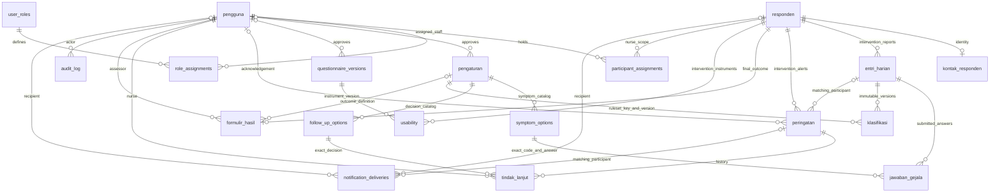

# TeleNapas ERD v1.0

Solid relations below are enforced foreign keys; optionality follows nullable
columns. The dictionary gives column types, keys and validation details.

`entri_harian`'s composite participant FK fixes `(id, kelompok, tanggal_pulang)`;
`hari_ke = DATEDIFF(tanggal_wib, tanggal_pulang)`. Its generated daily-only date
is unique per participant. Multiple repeat reports and multiple classification
versions are possible. Composite alert/entry and notification/alert relationships
prevent cross-participant references. A notification has exactly one participant
or staff recipient; there is no polymorphic recipient string.

This ERD describes stored relationships, not operational permission or a clinical
workflow. No identity fields are present in `responden`, no patient account is
created and no classification or notification is generated by saving an entry.

PR-03 adds the separate [authentication ERD](authentication-v1.1.md) without
changing these research relationships.

The [v1.2 scope amendment](grant-scopes-v1.2.md) adds explicit scope bindings to
identified-access grants; a parent grant alone grants no patient-data access.

PR-11 adds the optional provenance relationship `pengaturan o|--o{ entri_harian`
through `assessment_setting_id`; historical rows remain unlinked. See the
[daily-assessment ERD/amendment](daily-assessment-v1.4.md).
