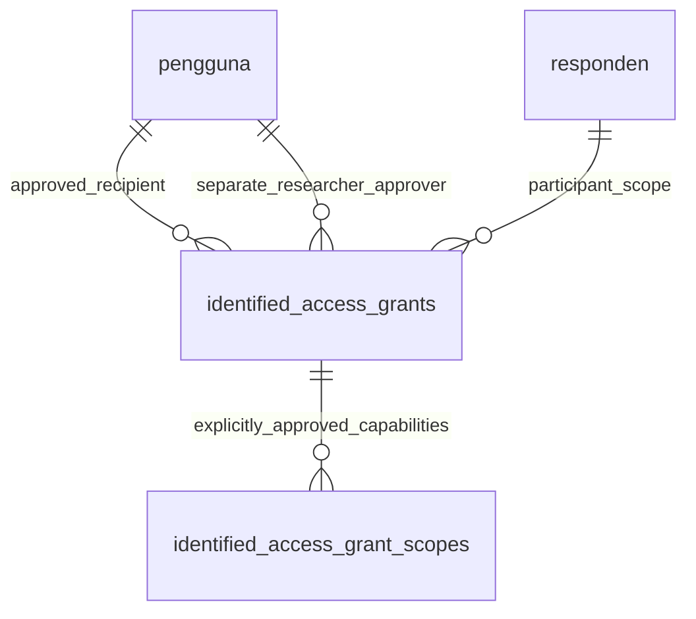

# ADMIN_IT grant-scope Data Dictionary v1.2

This PR #3 correction adds explicit capabilities to the
[authentication schema](authentication-v1.1.md). Migration
`2026_11_03_000004_add_explicit_identified_access_grant_scopes.php` creates only
the new binding table. It does not rewrite prior migrations, parent approvals,
research records, authentication credentials or immutable audit constraints.

| Column | SQL type | Meaning / integrity |
| --- | --- | --- |
| id | BIGINT UNSIGNED | Auto-increment primary key |
| grant_id | BIGINT UNSIGNED NOT NULL | FK to identified_access_grants.id; RESTRICT update/delete |
| scope | VARCHAR(16) NOT NULL, utf8mb4_bin | Byte-exact CHECK: TECHNICAL, CONTACT or CLINICAL_READ; no wildcard, default or hierarchy |
| created_at, updated_at | TIMESTAMP(6) NULL | Laravel UTC creation/update metadata |

`UNIQUE(grant_id, scope)` prevents duplicate bindings. `IdentifiedAccessGrant`
has many `IdentifiedAccessGrantScope` records; each binding belongs to its parent
and uses the `AccessGrantScope` backed enum. The unique index supports exact-scope
existence queries. Scope creation occurs with the researcher-approved parent and
its audit events in one transaction. The API requires a list of 1–3 distinct
known scopes and returns the approved set with the grant ID/expiry.

| Scope | Contact endpoint | Clinical summary/list | Monitoring / outcomes |
| --- | --- | --- | --- |
| TECHNICAL | Denied | Denied, including counts | Denied |
| CONTACT | Allowed for approved participant | Denied, including baseline VAS | Denied |
| CLINICAL_READ | Denied | Allowed for approved participant | Allowed subject to blinding and role restrictions |

Scopes may be combined, but none implies another. Every capability requires an
exact binding on an active, unrevoked, unexpired grant for the same staff and
participant with a currently qualified researcher approver. An ADMIN_IT account
with other roles still follows these checks. Assessors remain barred from
contacts; blinded assessors remain barred from monitoring even with all scopes.
Technical staff-session revocation remains an ADMIN_IT role operation and is not
an authorization to read participant resources.

Legacy parent grants deliberately receive **no scope backfill**. Their fields
remain unchanged, but no scope means no patient-data authorization. A researcher
must approve a new explicit set through the API; missing `scopes` receives 422.
There is no endpoint to silently expand the scope set of an existing approval.
Revoking a parent revokes all its capabilities; approvals and canonical scope
codes are appended to the existing immutable audit log without sensitive data.

Apply the migration before serving the corrected code. Never downgrade to the
old broad-grant authorization logic. `down()` drops only the binding table and
is for isolated test validation, not an operational rollback procedure. Full
apply/rollback/reapply and legacy-upgrade tests use separate, initially empty,
disposable MySQL schemas. `GrantScopeMigrationTest` is opt-in with
`TELENAPAS_MIGRATION_TESTS=1` and requires a schema name ending
`_grant_scope_migration_test`; it verifies unchanged legacy rows, zero inferred
permissions, TECHNICAL denial, retained audit immutability and safe reapply.
